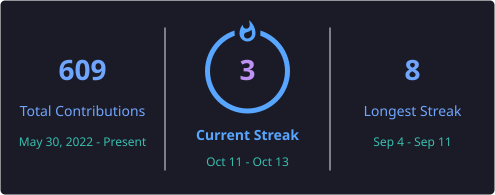

 

---

## About

DevOps engineer based in Tunis, Tunisia. I build and automate infrastructure across AWS, Azure, and GCP, as well as private cloud on OpenStack and VMware — infrastructure as code with Terraform and Ansible, container platforms on Kubernetes, GitOps delivery with ArgoCD, and observability with Grafana, Prometheus, and the ELK stack.

- Currently working on cloud cost engineering (FinOps) and migration automation
- Building and operating GPU infrastructure for AI/ML workloads on both NVIDIA and AMD — GPU-enabled Kubernetes nodes, driver and operator lifecycle, and utilization monitoring with DCGM
- Shifting security left in CI/CD — image and IaC scanning with Trivy, static analysis with SonarQube, and centralized secrets management with Infisical
- Comfortable across all three major clouds, with Terraform as the common thread
- I like turning manual, error-prone ops work into pipelines that just run
- Reach me on [LinkedIn](https://www.linkedin.com/in/youssef-omar-bouden-348b6a197/)

---

## Tech Stack

**Cloud Platforms**

  
  
  

**Private Cloud & On-Prem**

  
  

**Infrastructure as Code & Configuration Management**

  
  
  
  

**Containers & Orchestration**

  
  
  

**AI Infrastructure**

  
  
  
  
  
  
  

**CI/CD & GitOps**

  
  
  
  

**Security & DevSecOps**

  
  
  

**Observability & Logging**

  
  
  
  
  
  

**Languages**

  
  
  
  
  

---

## GitHub Stats

 

---

## Open Source Contributions

<!-- OSS-CONTRIBUTIONS:START -->

**48 pull requests across 34 open source projects** &nbsp;·&nbsp; 10 merged &nbsp;·&nbsp; 38 in review

| Project | Stars | Merged | In review |
| --- | ---: | ---: | ---: |
| [llm-d/llm-d](https://github.com/llm-d/llm-d) | 4,825 | [4](https://github.com/llm-d/llm-d/pulls?q=is%3Apr%20author%3Ablacksoxx%20is%3Amerged) | – |
| [llm-d/llm-d-router](https://github.com/llm-d/llm-d-router) | 401 | [3](https://github.com/llm-d/llm-d-router/pulls?q=is%3Apr%20author%3Ablacksoxx%20is%3Amerged) | – |
| [GoogleCloudPlatform/cluster-toolkit](https://github.com/GoogleCloudPlatform/cluster-toolkit) | 366 | [1](https://github.com/GoogleCloudPlatform/cluster-toolkit/pulls?q=is%3Apr%20author%3Ablacksoxx%20is%3Amerged) | – |
| [aws-controllers-k8s/eks-controller](https://github.com/aws-controllers-k8s/eks-controller) | 48 | [1](https://github.com/aws-controllers-k8s/eks-controller/pulls?q=is%3Apr%20author%3Ablacksoxx%20is%3Amerged) | – |
| [kubescape/prometheus-exporter](https://github.com/kubescape/prometheus-exporter) | 2 | [1](https://github.com/kubescape/prometheus-exporter/pulls?q=is%3Apr%20author%3Ablacksoxx%20is%3Amerged) | – |
| [pulumi/pulumi](https://github.com/pulumi/pulumi) | 25,789 | – | [7](https://github.com/pulumi/pulumi/pulls?q=is%3Apr%20author%3Ablacksoxx%20is%3Aopen) |
| [containerd/containerd](https://github.com/containerd/containerd) | 21,408 | – | [1](https://github.com/containerd/containerd/pulls?q=is%3Apr%20author%3Ablacksoxx%20is%3Aopen) |
| [linkerd/linkerd2](https://github.com/linkerd/linkerd2) | 11,514 | – | [1](https://github.com/linkerd/linkerd2/pulls?q=is%3Apr%20author%3Ablacksoxx%20is%3Aopen) |
| [loft-sh/vcluster](https://github.com/loft-sh/vcluster) | 11,348 | – | [1](https://github.com/loft-sh/vcluster/pulls?q=is%3Apr%20author%3Ablacksoxx%20is%3Aopen) |
| [gruntwork-io/terragrunt](https://github.com/gruntwork-io/terragrunt) | 9,879 | – | [1](https://github.com/gruntwork-io/terragrunt/pulls?q=is%3Apr%20author%3Ablacksoxx%20is%3Aopen) |
| [kgateway-dev/kgateway](https://github.com/kgateway-dev/kgateway) | 5,706 | – | [1](https://github.com/kgateway-dev/kgateway/pulls?q=is%3Apr%20author%3Ablacksoxx%20is%3Aopen) |
| [argoproj/argo-events](https://github.com/argoproj/argo-events) | 2,701 | – | [1](https://github.com/argoproj/argo-events/pulls?q=is%3Apr%20author%3Ablacksoxx%20is%3Aopen) |
| [hashicorp/terraform-ls](https://github.com/hashicorp/terraform-ls) | 1,206 | – | [2](https://github.com/hashicorp/terraform-ls/pulls?q=is%3Apr%20author%3Ablacksoxx%20is%3Aopen) |
| [GoogleCloudPlatform/k8s-config-connector](https://github.com/GoogleCloudPlatform/k8s-config-connector) | 1,071 | – | [1](https://github.com/GoogleCloudPlatform/k8s-config-connector/pulls?q=is%3Apr%20author%3Ablacksoxx%20is%3Aopen) |
| [gophercloud/gophercloud](https://github.com/gophercloud/gophercloud) | 1,014 | – | [1](https://github.com/gophercloud/gophercloud/pulls?q=is%3Apr%20author%3Ablacksoxx%20is%3Aopen) |
| [kubernetes-sigs/cluster-api-provider-aws](https://github.com/kubernetes-sigs/cluster-api-provider-aws) | 730 | – | [1](https://github.com/kubernetes-sigs/cluster-api-provider-aws/pulls?q=is%3Apr%20author%3Ablacksoxx%20is%3Aopen) |
| [awslabs/automated-security-helper](https://github.com/awslabs/automated-security-helper) | 703 | – | [1](https://github.com/awslabs/automated-security-helper/pulls?q=is%3Apr%20author%3Ablacksoxx%20is%3Aopen) |
| [hashicorp/terraform-provider-vault](https://github.com/hashicorp/terraform-provider-vault) | 513 | – | [2](https://github.com/hashicorp/terraform-provider-vault/pulls?q=is%3Apr%20author%3Ablacksoxx%20is%3Aopen) |
| [crossplane/upjet](https://github.com/crossplane/upjet) | 482 | – | [1](https://github.com/crossplane/upjet/pulls?q=is%3Apr%20author%3Ablacksoxx%20is%3Aopen) |
| [open-telemetry/otel-arrow](https://github.com/open-telemetry/otel-arrow) | 431 | – | [1](https://github.com/open-telemetry/otel-arrow/pulls?q=is%3Apr%20author%3Ablacksoxx%20is%3Aopen) |
| [aws/smithy-go](https://github.com/aws/smithy-go) | 257 | – | [1](https://github.com/aws/smithy-go/pulls?q=is%3Apr%20author%3Ablacksoxx%20is%3Aopen) |
| [jaegertracing/jaeger-idl](https://github.com/jaegertracing/jaeger-idl) | 104 | – | [1](https://github.com/jaegertracing/jaeger-idl/pulls?q=is%3Apr%20author%3Ablacksoxx%20is%3Aopen) |
| [aws-controllers-k8s/rds-controller](https://github.com/aws-controllers-k8s/rds-controller) | 103 | – | [1](https://github.com/aws-controllers-k8s/rds-controller/pulls?q=is%3Apr%20author%3Ablacksoxx%20is%3Aopen) |
| [FluidifyAI/Regen](https://github.com/FluidifyAI/Regen) | 87 | – | [1](https://github.com/FluidifyAI/Regen/pulls?q=is%3Apr%20author%3Ablacksoxx%20is%3Aopen) |

…and 10 more projects.

<!-- OSS-CONTRIBUTIONS:END -->

---

## Featured Projects

| Project | What it is | Stack |
| --- | --- | --- |
| [azure-go-task-manager](https://github.com/blacksoxx/azure-go-task-manager) | Cloud-native task management system with Go microservices, deployed on Kubernetes using GitOps | Go, Kubernetes, ArgoCD, Kustomize, Azure |
| [gcp-microservices-tf](https://github.com/blacksoxx/gcp-microservices-tf) | Terraform project hosting Google's "Online Boutique" microservices demo on GCP | Terraform, GKE, GCP |
| [hybrid-cloud-monitoring](https://github.com/blacksoxx/hybrid-cloud-monitoring) | Cross-cloud observability: provision and monitor AWS and Azure resources from one setup | Terraform, Grafana, AWS, Azure |
| [aws-ai-log-analytics-platform](https://github.com/blacksoxx/aws-ai-log-analytics-platform) | AI-powered cloud-native log analytics platform | TypeScript, AWS |
| [aws-serverless-traffic-control-system](https://github.com/blacksoxx/aws-serverless-traffic-control-system) | Intelligent serverless traffic light control system | Python, AWS Lambda |
| [vmware-migration-automated](https://github.com/blacksoxx/vmware-migration-automated) | Automation for migrating VMware workloads to the cloud | Python, VMware |

---

Thanks for stopping by — feel free to explore the repos or reach out.

