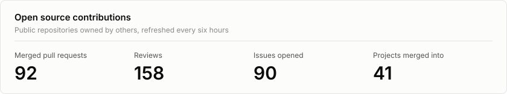
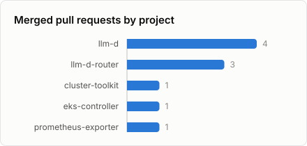
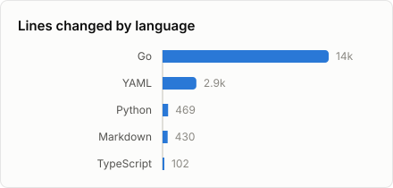

# Youssef Omar Bouden

DevOps engineer in Tunis, Tunisia. I build cloud and GPU infrastructure for AI/ML teams and automate the operations around it.

## About

- Platform engineering across AWS, Azure, GCP, OpenStack and VMware, with Terraform as the common thread and Argo CD for delivery.
- GPU infrastructure for AI/ML on NVIDIA and AMD: GPU-enabled Kubernetes nodes, driver and operator lifecycle, utilisation monitoring with DCGM.
- Current focus: cloud cost engineering (FinOps), migration automation, and shifting security left in CI/CD with Trivy, SonarQube and Infisical.
- Upstream, most of my work goes into [llm-d](https://github.com/llm-d), Kubernetes-native distributed inference, alongside fixes across the Kubernetes and cloud provider ecosystem.

<!--
## Certifications

The profile bio lists three AWS certifications. List them here with Credly links, for example:

- AWS Certified Solutions Architect, Associate (Credly link)
-->

## Open source

<!-- OSS-CONTRIBUTIONS:START -->

<picture>
  <source media="(prefers-color-scheme: dark)" srcset="profile/oss-summary-dark.svg">
  
</picture>

### Merged pull requests

| Merged | Project | Pull request |
| --- | --- | --- |
| 2026-10-13 | [aws-controllers-k8s/eks-controller](https://github.com/aws-controllers-k8s/eks-controller) | [fix: skip upgradePolicy and component config updates when spec values are nil](https://github.com/aws-controllers-k8s/eks-controller/pull/262) |
| 2026-10-13 | [llm-d/llm-d-router](https://github.com/llm-d/llm-d-router) | [fix(coordinator): answer every inference rejection with the OpenAI error envelope](https://github.com/llm-d/llm-d-router/pull/3393) |
| 2026-10-13 | [GoogleCloudPlatform/cluster-toolkit](https://github.com/GoogleCloudPlatform/cluster-toolkit) | [fix(gpu-rdma-vpc): drop the always-true null check on network_profile](https://github.com/GoogleCloudPlatform/cluster-toolkit/pull/6444) |
| 2026-10-13 | [llm-d/llm-d](https://github.com/llm-d/llm-d) | [guides: fix stale claims in wide-ep, omni, GLM, Nemotron and tiered pages](https://github.com/llm-d/llm-d/pull/2742) |
| 2026-10-13 | [llm-d/llm-d](https://github.com/llm-d/llm-d) | [guides: fix selectors, ports and storage class that break deployments](https://github.com/llm-d/llm-d/pull/2734) |
| 2026-10-12 | [llm-d/llm-d](https://github.com/llm-d/llm-d) | [docs: fix quickstart, readiness and observability pages](https://github.com/llm-d/llm-d/pull/2741) |
| 2026-10-12 | [llm-d/llm-d](https://github.com/llm-d/llm-d) | [docs(architecture): correct router defaults, status codes and names](https://github.com/llm-d/llm-d/pull/2735) |
| 2026-10-09 | [kubescape/prometheus-exporter](https://github.com/kubescape/prometheus-exporter) | [feat(metrics): export negligible vulnerability counts](https://github.com/kubescape/prometheus-exporter/pull/61) |
| 2026-10-08 | [llm-d/llm-d-router](https://github.com/llm-d/llm-d-router) | [chore: use the shared content-type constants across EPP and coordinator](https://github.com/llm-d/llm-d-router/pull/3225) |
| 2026-10-07 | [llm-d/llm-d-router](https://github.com/llm-d/llm-d-router) | [fix(epp): serialize rejections as JSON error envelopes](https://github.com/llm-d/llm-d-router/pull/3207) |

### Reviews and issues

- Reviewed [4 pull requests](https://github.com/search?q=is%3Apr+reviewed-by%3Ablacksoxx+-author%3Ablacksoxx&type=pullrequests) in [llm-d/llm-d-router](https://github.com/llm-d/llm-d-router).
- Opened [2 issues](https://github.com/search?q=is%3Aissue+author%3Ablacksoxx+-user%3Ablacksoxx&type=issues) in [FluidifyAI/Regen](https://github.com/FluidifyAI/Regen) and [hashicorp/terraform-ls](https://github.com/hashicorp/terraform-ls).

<picture>
  <source media="(prefers-color-scheme: dark)" srcset="profile/oss-projects-dark.svg">
  
</picture>
<picture>
  <source media="(prefers-color-scheme: dark)" srcset="profile/oss-languages-dark.svg">
  
</picture>

All 38 projects, including 45 open pull requests

| Project | Stars | Merged | Reviewed | Open |
| --- | ---: | ---: | ---: | ---: |
| [llm-d/llm-d](https://github.com/llm-d/llm-d) | 4.8k | [4](https://github.com/llm-d/llm-d/pulls?q=is%3Apr+author%3Ablacksoxx+is%3Amerged) | – | – |
| [llm-d/llm-d-router](https://github.com/llm-d/llm-d-router) | 402 | [3](https://github.com/llm-d/llm-d-router/pulls?q=is%3Apr+author%3Ablacksoxx+is%3Amerged) | [4](https://github.com/llm-d/llm-d-router/pulls?q=is%3Apr+reviewed-by%3Ablacksoxx+-author%3Ablacksoxx) | [1](https://github.com/llm-d/llm-d-router/pulls?q=is%3Apr+author%3Ablacksoxx+is%3Aopen) |
| [GoogleCloudPlatform/cluster-toolkit](https://github.com/GoogleCloudPlatform/cluster-toolkit) | 366 | [1](https://github.com/GoogleCloudPlatform/cluster-toolkit/pulls?q=is%3Apr+author%3Ablacksoxx+is%3Amerged) | – | – |
| [aws-controllers-k8s/eks-controller](https://github.com/aws-controllers-k8s/eks-controller) | 48 | [1](https://github.com/aws-controllers-k8s/eks-controller/pulls?q=is%3Apr+author%3Ablacksoxx+is%3Amerged) | – | – |
| [kubescape/prometheus-exporter](https://github.com/kubescape/prometheus-exporter) | 2 | [1](https://github.com/kubescape/prometheus-exporter/pulls?q=is%3Apr+author%3Ablacksoxx+is%3Amerged) | – | – |
| [pulumi/pulumi](https://github.com/pulumi/pulumi) | 25.8k | – | – | [7](https://github.com/pulumi/pulumi/pulls?q=is%3Apr+author%3Ablacksoxx+is%3Aopen) |
| [containerd/containerd](https://github.com/containerd/containerd) | 21.4k | – | – | [1](https://github.com/containerd/containerd/pulls?q=is%3Apr+author%3Ablacksoxx+is%3Aopen) |
| [linkerd/linkerd2](https://github.com/linkerd/linkerd2) | 11.5k | – | – | [1](https://github.com/linkerd/linkerd2/pulls?q=is%3Apr+author%3Ablacksoxx+is%3Aopen) |
| [loft-sh/vcluster](https://github.com/loft-sh/vcluster) | 11.3k | – | – | [1](https://github.com/loft-sh/vcluster/pulls?q=is%3Apr+author%3Ablacksoxx+is%3Aopen) |
| [gruntwork-io/terragrunt](https://github.com/gruntwork-io/terragrunt) | 9.9k | – | – | [1](https://github.com/gruntwork-io/terragrunt/pulls?q=is%3Apr+author%3Ablacksoxx+is%3Aopen) |
| [kgateway-dev/kgateway](https://github.com/kgateway-dev/kgateway) | 5.7k | – | – | [1](https://github.com/kgateway-dev/kgateway/pulls?q=is%3Apr+author%3Ablacksoxx+is%3Aopen) |
| [argoproj/argo-events](https://github.com/argoproj/argo-events) | 2.7k | – | – | [1](https://github.com/argoproj/argo-events/pulls?q=is%3Apr+author%3Ablacksoxx+is%3Aopen) |
| [hashicorp/terraform-ls](https://github.com/hashicorp/terraform-ls) | 1.2k | – | – | [2](https://github.com/hashicorp/terraform-ls/pulls?q=is%3Apr+author%3Ablacksoxx+is%3Aopen) |
| [GoogleCloudPlatform/k8s-config-connector](https://github.com/GoogleCloudPlatform/k8s-config-connector) | 1.1k | – | – | [2](https://github.com/GoogleCloudPlatform/k8s-config-connector/pulls?q=is%3Apr+author%3Ablacksoxx+is%3Aopen) |
| [gophercloud/gophercloud](https://github.com/gophercloud/gophercloud) | 1k | – | – | [1](https://github.com/gophercloud/gophercloud/pulls?q=is%3Apr+author%3Ablacksoxx+is%3Aopen) |
| [kubernetes-sigs/cluster-api-provider-aws](https://github.com/kubernetes-sigs/cluster-api-provider-aws) | 730 | – | – | [1](https://github.com/kubernetes-sigs/cluster-api-provider-aws/pulls?q=is%3Apr+author%3Ablacksoxx+is%3Aopen) |
| [awslabs/automated-security-helper](https://github.com/awslabs/automated-security-helper) | 703 | – | – | [1](https://github.com/awslabs/automated-security-helper/pulls?q=is%3Apr+author%3Ablacksoxx+is%3Aopen) |
| [hashicorp/terraform-provider-vault](https://github.com/hashicorp/terraform-provider-vault) | 513 | – | – | [2](https://github.com/hashicorp/terraform-provider-vault/pulls?q=is%3Apr+author%3Ablacksoxx+is%3Aopen) |
| [crossplane/upjet](https://github.com/crossplane/upjet) | 482 | – | – | [1](https://github.com/crossplane/upjet/pulls?q=is%3Apr+author%3Ablacksoxx+is%3Aopen) |
| [open-telemetry/otel-arrow](https://github.com/open-telemetry/otel-arrow) | 432 | – | – | [1](https://github.com/open-telemetry/otel-arrow/pulls?q=is%3Apr+author%3Ablacksoxx+is%3Aopen) |
| [pulumi/pulumi-kubernetes-operator](https://github.com/pulumi/pulumi-kubernetes-operator) | 293 | – | – | [2](https://github.com/pulumi/pulumi-kubernetes-operator/pulls?q=is%3Apr+author%3Ablacksoxx+is%3Aopen) |
| [aws/smithy-go](https://github.com/aws/smithy-go) | 257 | – | – | [1](https://github.com/aws/smithy-go/pulls?q=is%3Apr+author%3Ablacksoxx+is%3Aopen) |
| [jaegertracing/jaeger-idl](https://github.com/jaegertracing/jaeger-idl) | 104 | – | – | [1](https://github.com/jaegertracing/jaeger-idl/pulls?q=is%3Apr+author%3Ablacksoxx+is%3Aopen) |
| [aws-controllers-k8s/rds-controller](https://github.com/aws-controllers-k8s/rds-controller) | 103 | – | – | [1](https://github.com/aws-controllers-k8s/rds-controller/pulls?q=is%3Apr+author%3Ablacksoxx+is%3Aopen) |
| [FluidifyAI/Regen](https://github.com/FluidifyAI/Regen) | 87 | – | – | [1](https://github.com/FluidifyAI/Regen/pulls?q=is%3Apr+author%3Ablacksoxx+is%3Aopen) |
| [upbound/provider-opentofu](https://github.com/upbound/provider-opentofu) | 63 | – | – | [1](https://github.com/upbound/provider-opentofu/pulls?q=is%3Apr+author%3Ablacksoxx+is%3Aopen) |
| [turbot/steampipe-mod-azure-compliance](https://github.com/turbot/steampipe-mod-azure-compliance) | 61 | – | – | [2](https://github.com/turbot/steampipe-mod-azure-compliance/pulls?q=is%3Apr+author%3Ablacksoxx+is%3Aopen) |
| [k0sproject/rig](https://github.com/k0sproject/rig) | 53 | – | – | [1](https://github.com/k0sproject/rig/pulls?q=is%3Apr+author%3Ablacksoxx+is%3Aopen) |
| [falcosecurity/falco-operator](https://github.com/falcosecurity/falco-operator) | 47 | – | – | [1](https://github.com/falcosecurity/falco-operator/pulls?q=is%3Apr+author%3Ablacksoxx+is%3Aopen) |
| [aws-controllers-k8s/ec2-controller](https://github.com/aws-controllers-k8s/ec2-controller) | 44 | – | – | [1](https://github.com/aws-controllers-k8s/ec2-controller/pulls?q=is%3Apr+author%3Ablacksoxx+is%3Aopen) |
| [crossplane/cli](https://github.com/crossplane/cli) | 20 | – | – | [1](https://github.com/crossplane/cli/pulls?q=is%3Apr+author%3Ablacksoxx+is%3Aopen) |
| [aws-controllers-k8s/sqs-controller](https://github.com/aws-controllers-k8s/sqs-controller) | 11 | – | – | [1](https://github.com/aws-controllers-k8s/sqs-controller/pulls?q=is%3Apr+author%3Ablacksoxx+is%3Aopen) |
| [aws-controllers-k8s/elbv2-controller](https://github.com/aws-controllers-k8s/elbv2-controller) | 7 | – | – | [1](https://github.com/aws-controllers-k8s/elbv2-controller/pulls?q=is%3Apr+author%3Ablacksoxx+is%3Aopen) |
| [aws-controllers-k8s/wafv2-controller](https://github.com/aws-controllers-k8s/wafv2-controller) | 5 | – | – | [1](https://github.com/aws-controllers-k8s/wafv2-controller/pulls?q=is%3Apr+author%3Ablacksoxx+is%3Aopen) |
| [aws-controllers-k8s/cloudwatch-controller](https://github.com/aws-controllers-k8s/cloudwatch-controller) | 3 | – | – | [1](https://github.com/aws-controllers-k8s/cloudwatch-controller/pulls?q=is%3Apr+author%3Ablacksoxx+is%3Aopen) |
| [llm-d/llm-d-infra](https://github.com/llm-d/llm-d-infra) | 2 | – | – | [1](https://github.com/llm-d/llm-d-infra/pulls?q=is%3Apr+author%3Ablacksoxx+is%3Aopen) |
| [anchore/go-rpmdb](https://github.com/anchore/go-rpmdb) | 1 | – | – | [1](https://github.com/anchore/go-rpmdb/pulls?q=is%3Apr+author%3Ablacksoxx+is%3Aopen) |
| [aws-controllers-k8s/athena-controller](https://github.com/aws-controllers-k8s/athena-controller) | 0 | – | – | [1](https://github.com/aws-controllers-k8s/athena-controller/pulls?q=is%3Apr+author%3Ablacksoxx+is%3Aopen) |

<!-- OSS-CONTRIBUTIONS:END -->

## Featured projects

| Project | What it shows | Stack |
| --- | --- | --- |
| [azure-go-task-manager](https://github.com/blacksoxx/azure-go-task-manager) | Go microservices delivered to Kubernetes through Argo CD and Kustomize overlays | Go, Kubernetes, Argo CD, Kustomize, Azure |
| [gcp-microservices-tf](https://github.com/blacksoxx/gcp-microservices-tf) | Terraform that stands up GKE and hosts Google's Online Boutique demo end to end | Terraform, GKE, GCP |
| [hybrid-cloud-monitoring](https://github.com/blacksoxx/hybrid-cloud-monitoring) | One Terraform setup provisioning AWS and Azure resources with a single Grafana view across both | Terraform, Grafana, AWS, Azure |

## Tech stack

| Area | Tools |
| --- | --- |
| Cloud | AWS, Azure, Google Cloud, OpenStack, VMware |
| Infrastructure as code | Terraform, Ansible, Helm, Kustomize |
| Containers | Kubernetes, Docker, Podman |
| AI infrastructure | NVIDIA GPU Operator, Container Toolkit, DCGM, CUDA, AMD ROCm |
| CI/CD and GitOps | GitHub Actions, Jenkins, Argo CD |
| Security | Trivy, SonarQube, Infisical |
| Observability | Prometheus, Grafana, Elasticsearch, Logstash, Kibana, Sentry |
| Languages | Go, Python, TypeScript, Java, Bash |
