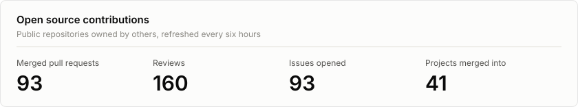
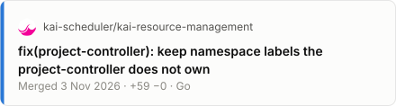
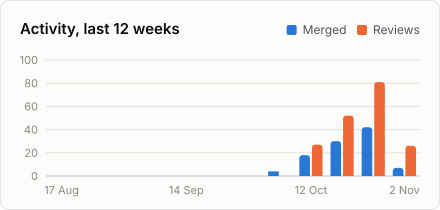
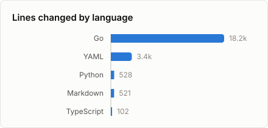

# Youssef Omar Bouden

DevOps engineer in Tunis, Tunisia. I build cloud and GPU infrastructure for AI/ML teams and automate the operations around it.

## About

- Platform engineering across AWS, Azure, GCP, OpenStack and VMware, with Terraform as the common thread and Argo CD for delivery.
- GPU infrastructure for AI/ML on NVIDIA and AMD: GPU-enabled Kubernetes nodes, driver and operator lifecycle, utilisation monitoring with DCGM.
- Current focus: cloud cost engineering (FinOps), migration automation, and shifting security left in CI/CD with Trivy, SonarQube and Infisical.
- Upstream, most of my work goes into [llm-d](https://github.com/llm-d), Kubernetes-native distributed inference, alongside fixes across the Kubernetes and cloud provider ecosystem.

## Certifications

| Certification | Issuer | Issued |
| --- | --- | --- |
| AWS Certified Machine Learning Engineer – Associate | Amazon Web Services | Aug 2026 |
| AWS Certified Solutions Architect – Associate | Amazon Web Services | Jan 2026 |
| Aviatrix Certified Engineer, Multicloud Network Associate | Aviatrix | Aug 2025 |
| AWS Certified Cloud Practitioner | Amazon Web Services | Mar 2025 |

Credentials are verifiable on [LinkedIn](https://www.linkedin.com/in/youssef-omar-bouden-348b6a197/details/certifications/).

## Open source

<!-- OSS-CONTRIBUTIONS:START -->

<picture>
  <source media="(prefers-color-scheme: dark)" srcset="profile/oss-summary-dark.svg">
  
</picture>

### Recent merged work

<a href="https://github.com/upbound/provider-upjet-civo/pull/51">
<picture>
  <source media="(prefers-color-scheme: dark)" srcset="profile/pr-1-dark.svg">
  
</picture>
</a>
<a href="https://github.com/NVIDIA/NVSentinel/pull/2287">
<picture>
  <source media="(prefers-color-scheme: dark)" srcset="profile/pr-2-dark.svg">
  
</picture>
</a>
<a href="https://github.com/kubescape/kubescape/pull/4822">
<picture>
  <source media="(prefers-color-scheme: dark)" srcset="profile/pr-3-dark.svg">
  
</picture>
</a>
<a href="https://github.com/gophercloud/gophercloud/pull/4044">
<picture>
  <source media="(prefers-color-scheme: dark)" srcset="profile/pr-4-dark.svg">
  
</picture>
</a>
<a href="https://github.com/aws-controllers-k8s/ec2-controller/pull/406">
<picture>
  <source media="(prefers-color-scheme: dark)" srcset="profile/pr-5-dark.svg">
  
</picture>
</a>
<a href="https://github.com/aws-controllers-k8s/elbv2-controller/pull/101">
<picture>
  <source media="(prefers-color-scheme: dark)" srcset="profile/pr-6-dark.svg">
  
</picture>
</a>
<a href="https://github.com/kai-scheduler/kai-resource-management/pull/201">
<picture>
  <source media="(prefers-color-scheme: dark)" srcset="profile/pr-7-dark.svg">
  
</picture>
</a>
<a href="https://github.com/kai-scheduler/gpu-fractioning/pull/183">
<picture>
  <source media="(prefers-color-scheme: dark)" srcset="profile/pr-8-dark.svg">
  
</picture>
</a>

[All 116 merged pull requests](https://github.com/search?q=is%3Apr+author%3Ablacksoxx+is%3Amerged+-user%3Ablacksoxx&type=pullrequests)

### Projects

<table>
<tr>
<td align="center" width="16%"><a href="https://github.com/search?q=is%3Apr+author%3Ablacksoxx+is%3Amerged+user%3Akubescape&type=pullrequests"> <b>kubescape</b></a> 34 merged</td>
<td align="center" width="16%"><a href="https://github.com/search?q=is%3Apr+author%3Ablacksoxx+is%3Amerged+user%3Allm-d&type=pullrequests"> <b>llm-d</b></a> 25 merged</td>
<td align="center" width="16%"><a href="https://github.com/search?q=is%3Apr+author%3Ablacksoxx+is%3Amerged+user%3Aaws-controllers-k8s&type=pullrequests"> <b>aws-controllers-k8s</b></a> 21 merged</td>
<td align="center" width="16%"><a href="https://github.com/search?q=is%3Apr+author%3Ablacksoxx+is%3Amerged+user%3ANVIDIA&type=pullrequests"> <b>NVIDIA</b></a> 7 merged</td>
<td align="center" width="16%"><a href="https://github.com/search?q=is%3Apr+author%3Ablacksoxx+is%3Amerged+user%3Akai-scheduler&type=pullrequests"> <b>kai-scheduler</b></a> 6 merged</td>
<td align="center" width="16%"><a href="https://github.com/search?q=is%3Apr+author%3Ablacksoxx+is%3Amerged+user%3Apulumi&type=pullrequests"> <b>pulumi</b></a> 4 merged</td>
</tr>
<tr>
<td align="center" width="16%"><a href="https://github.com/search?q=is%3Apr+author%3Ablacksoxx+is%3Amerged+user%3AGoogleCloudPlatform&type=pullrequests"> <b>GoogleCloudPlatform</b></a> 4 merged</td>
<td align="center" width="16%"><a href="https://github.com/search?q=is%3Apr+author%3Ablacksoxx+is%3Amerged+user%3Aturbot&type=pullrequests"> <b>turbot</b></a> 2 merged</td>
<td align="center" width="16%"><a href="https://github.com/search?q=is%3Apr+author%3Ablacksoxx+is%3Amerged+user%3Akgateway-dev&type=pullrequests"> <b>kgateway-dev</b></a> 1 merged</td>
<td align="center" width="16%"><a href="https://github.com/search?q=is%3Apr+author%3Ablacksoxx+is%3Amerged+user%3Aaws-cloudformation&type=pullrequests"> <b>aws-cloudformation</b></a> 1 merged</td>
<td align="center" width="16%"><a href="https://github.com/search?q=is%3Apr+author%3Ablacksoxx+is%3Amerged+user%3Adragonflyoss&type=pullrequests"> <b>dragonflyoss</b></a> 1 merged</td>
<td align="center" width="16%"><a href="https://github.com/search?q=is%3Apr+author%3Ablacksoxx+is%3Amerged+user%3Agophercloud&type=pullrequests"> <b>gophercloud</b></a> 1 merged</td>
</tr>
<tr>
<td align="center" width="16%"><a href="https://github.com/search?q=is%3Apr+author%3Ablacksoxx+is%3Amerged+user%3Adapr&type=pullrequests"> <b>dapr</b></a> 1 merged</td>
<td align="center" width="16%"><a href="https://github.com/search?q=is%3Apr+author%3Ablacksoxx+is%3Amerged+user%3Aaws&type=pullrequests"> <b>aws</b></a> 1 merged</td>
<td align="center" width="16%"><a href="https://github.com/search?q=is%3Apr+author%3Ablacksoxx+is%3Amerged+user%3AFluidifyAI&type=pullrequests"> <b>FluidifyAI</b></a> 1 merged</td>
<td align="center" width="16%"><a href="https://github.com/search?q=is%3Apr+author%3Ablacksoxx+is%3Amerged+user%3Ak0sproject&type=pullrequests"> <b>k0sproject</b></a> 1 merged</td>
<td align="center" width="16%"><a href="https://github.com/search?q=is%3Apr+author%3Ablacksoxx+is%3Amerged+user%3ADokploy&type=pullrequests"> <b>Dokploy</b></a> 1 merged</td>
<td align="center" width="16%"><a href="https://github.com/search?q=is%3Apr+author%3Ablacksoxx+is%3Amerged+user%3Afalcosecurity&type=pullrequests"> <b>falcosecurity</b></a> 1 merged</td>
</tr>
<tr>
<td align="center" width="16%"><a href="https://github.com/search?q=is%3Apr+author%3Ablacksoxx+is%3Amerged+user%3Araedbrahem&type=pullrequests"> <b>raedbrahem</b></a> 1 merged</td>
<td align="center" width="16%"><a href="https://github.com/search?q=is%3Apr+author%3Ablacksoxx+is%3Amerged+user%3Aseneca-innovation-center&type=pullrequests"> <b>seneca-innovation-center</b></a> 1 merged</td>
<td align="center" width="16%"><a href="https://github.com/search?q=is%3Apr+author%3Ablacksoxx+is%3Amerged+user%3Aupbound&type=pullrequests"> <b>upbound</b></a> 1 merged</td>
</tr>
</table>

Open pull requests in 25 more organisations:

### Reviews and issues

- Reviewed [260 pull requests](https://github.com/search?q=is%3Apr+reviewed-by%3Ablacksoxx+-author%3Ablacksoxx&type=pullrequests) in [llm-d/llm-d-router](https://github.com/llm-d/llm-d-router), [kai-scheduler/KAI-Scheduler](https://github.com/kai-scheduler/KAI-Scheduler), [loft-sh/vcluster](https://github.com/loft-sh/vcluster) and 55 more.
- Opened [131 issues](https://github.com/search?q=is%3Aissue+author%3Ablacksoxx+-user%3Ablacksoxx&type=issues) in [finopsfoundation/focus_validator](https://github.com/finopsfoundation/focus_validator), [llm-d/llm-d-router](https://github.com/llm-d/llm-d-router), [loft-sh/vcluster](https://github.com/loft-sh/vcluster) and 32 more.

<picture>
  <source media="(prefers-color-scheme: dark)" srcset="profile/oss-activity-dark.svg">
  
</picture>
<picture>
  <source media="(prefers-color-scheme: dark)" srcset="profile/oss-languages-dark.svg">
  
</picture>

All 143 projects, including 167 open pull requests

| Project | Stars | Merged | Reviewed | Open |
| --- | ---: | ---: | ---: | ---: |
| [llm-d/llm-d-router](https://github.com/llm-d/llm-d-router) | 467 | [18](https://github.com/llm-d/llm-d-router/pulls?q=is%3Apr+author%3Ablacksoxx+is%3Amerged) | [59](https://github.com/llm-d/llm-d-router/pulls?q=is%3Apr+reviewed-by%3Ablacksoxx+-author%3Ablacksoxx) | [1](https://github.com/llm-d/llm-d-router/pulls?q=is%3Apr+author%3Ablacksoxx+is%3Aopen) |
| [kubescape/operator](https://github.com/kubescape/operator) | 25 | [10](https://github.com/kubescape/operator/pulls?q=is%3Apr+author%3Ablacksoxx+is%3Amerged) | [3](https://github.com/kubescape/operator/pulls?q=is%3Apr+reviewed-by%3Ablacksoxx+-author%3Ablacksoxx) | – |
| [kubescape/storage](https://github.com/kubescape/storage) | 6 | [7](https://github.com/kubescape/storage/pulls?q=is%3Apr+author%3Ablacksoxx+is%3Amerged) | [6](https://github.com/kubescape/storage/pulls?q=is%3Apr+reviewed-by%3Ablacksoxx+-author%3Ablacksoxx) | – |
| [llm-d/llm-d](https://github.com/llm-d/llm-d) | 5.3k | [6](https://github.com/llm-d/llm-d/pulls?q=is%3Apr+author%3Ablacksoxx+is%3Amerged) | [8](https://github.com/llm-d/llm-d/pulls?q=is%3Apr+reviewed-by%3Ablacksoxx+-author%3Ablacksoxx) | [1](https://github.com/llm-d/llm-d/pulls?q=is%3Apr+author%3Ablacksoxx+is%3Aopen) |
| [NVIDIA/NVSentinel](https://github.com/NVIDIA/NVSentinel) | 438 | [6](https://github.com/NVIDIA/NVSentinel/pulls?q=is%3Apr+author%3Ablacksoxx+is%3Amerged) | [8](https://github.com/NVIDIA/NVSentinel/pulls?q=is%3Apr+reviewed-by%3Ablacksoxx+-author%3Ablacksoxx) | – |
| [kubescape/helm-charts](https://github.com/kubescape/helm-charts) | 42 | [6](https://github.com/kubescape/helm-charts/pulls?q=is%3Apr+author%3Ablacksoxx+is%3Amerged) | [2](https://github.com/kubescape/helm-charts/pulls?q=is%3Apr+reviewed-by%3Ablacksoxx+-author%3Ablacksoxx) | [1](https://github.com/kubescape/helm-charts/pulls?q=is%3Apr+author%3Ablacksoxx+is%3Aopen) |
| [kubescape/kubevuln](https://github.com/kubescape/kubevuln) | 26 | [5](https://github.com/kubescape/kubevuln/pulls?q=is%3Apr+author%3Ablacksoxx+is%3Amerged) | [3](https://github.com/kubescape/kubevuln/pulls?q=is%3Apr+reviewed-by%3Ablacksoxx+-author%3Ablacksoxx) | [1](https://github.com/kubescape/kubevuln/pulls?q=is%3Apr+author%3Ablacksoxx+is%3Aopen) |
| [kubescape/synchronizer](https://github.com/kubescape/synchronizer) | 3 | [4](https://github.com/kubescape/synchronizer/pulls?q=is%3Apr+author%3Ablacksoxx+is%3Amerged) | [3](https://github.com/kubescape/synchronizer/pulls?q=is%3Apr+reviewed-by%3Ablacksoxx+-author%3Ablacksoxx) | – |
| [kai-scheduler/kai-resource-management](https://github.com/kai-scheduler/kai-resource-management) | 47 | [3](https://github.com/kai-scheduler/kai-resource-management/pulls?q=is%3Apr+author%3Ablacksoxx+is%3Amerged) | – | – |
| [aws-controllers-k8s/ec2-controller](https://github.com/aws-controllers-k8s/ec2-controller) | 44 | [2](https://github.com/aws-controllers-k8s/ec2-controller/pulls?q=is%3Apr+author%3Ablacksoxx+is%3Amerged) | [4](https://github.com/aws-controllers-k8s/ec2-controller/pulls?q=is%3Apr+reviewed-by%3Ablacksoxx+-author%3Ablacksoxx) | [2](https://github.com/aws-controllers-k8s/ec2-controller/pulls?q=is%3Apr+author%3Ablacksoxx+is%3Aopen) |
| [aws-controllers-k8s/rds-controller](https://github.com/aws-controllers-k8s/rds-controller) | 104 | [2](https://github.com/aws-controllers-k8s/rds-controller/pulls?q=is%3Apr+author%3Ablacksoxx+is%3Amerged) | [1](https://github.com/aws-controllers-k8s/rds-controller/pulls?q=is%3Apr+reviewed-by%3Ablacksoxx+-author%3Ablacksoxx) | – |
| [aws-controllers-k8s/elasticache-controller](https://github.com/aws-controllers-k8s/elasticache-controller) | 24 | [2](https://github.com/aws-controllers-k8s/elasticache-controller/pulls?q=is%3Apr+author%3Ablacksoxx+is%3Amerged) | [1](https://github.com/aws-controllers-k8s/elasticache-controller/pulls?q=is%3Apr+reviewed-by%3Ablacksoxx+-author%3Ablacksoxx) | [1](https://github.com/aws-controllers-k8s/elasticache-controller/pulls?q=is%3Apr+author%3Ablacksoxx+is%3Aopen) |
| [pulumi/pulumi](https://github.com/pulumi/pulumi) | 25.9k | [2](https://github.com/pulumi/pulumi/pulls?q=is%3Apr+author%3Ablacksoxx+is%3Amerged) | – | [5](https://github.com/pulumi/pulumi/pulls?q=is%3Apr+author%3Ablacksoxx+is%3Aopen) |
| [pulumi/pulumi-kubernetes-operator](https://github.com/pulumi/pulumi-kubernetes-operator) | 294 | [2](https://github.com/pulumi/pulumi-kubernetes-operator/pulls?q=is%3Apr+author%3Ablacksoxx+is%3Amerged) | – | – |
| [GoogleCloudPlatform/opentelemetry-operations-collector](https://github.com/GoogleCloudPlatform/opentelemetry-operations-collector) | 84 | [2](https://github.com/GoogleCloudPlatform/opentelemetry-operations-collector/pulls?q=is%3Apr+author%3Ablacksoxx+is%3Amerged) | – | – |
| [turbot/steampipe-mod-azure-compliance](https://github.com/turbot/steampipe-mod-azure-compliance) | 61 | [2](https://github.com/turbot/steampipe-mod-azure-compliance/pulls?q=is%3Apr+author%3Ablacksoxx+is%3Amerged) | – | – |
| [kai-scheduler/gpu-fractioning](https://github.com/kai-scheduler/gpu-fractioning) | 59 | [2](https://github.com/kai-scheduler/gpu-fractioning/pulls?q=is%3Apr+author%3Ablacksoxx+is%3Amerged) | – | [4](https://github.com/kai-scheduler/gpu-fractioning/pulls?q=is%3Apr+author%3Ablacksoxx+is%3Aopen) |
| [aws-controllers-k8s/eks-controller](https://github.com/aws-controllers-k8s/eks-controller) | 48 | [2](https://github.com/aws-controllers-k8s/eks-controller/pulls?q=is%3Apr+author%3Ablacksoxx+is%3Amerged) | – | – |
| [kai-scheduler/KAI-Scheduler](https://github.com/kai-scheduler/KAI-Scheduler) | 1.6k | [1](https://github.com/kai-scheduler/KAI-Scheduler/pulls?q=is%3Apr+author%3Ablacksoxx+is%3Amerged) | [31](https://github.com/kai-scheduler/KAI-Scheduler/pulls?q=is%3Apr+reviewed-by%3Ablacksoxx+-author%3Ablacksoxx) | [2](https://github.com/kai-scheduler/KAI-Scheduler/pulls?q=is%3Apr+author%3Ablacksoxx+is%3Aopen) |
| [aws-cloudformation/cfn-lint](https://github.com/aws-cloudformation/cfn-lint) | 2.6k | [1](https://github.com/aws-cloudformation/cfn-lint/pulls?q=is%3Apr+author%3Ablacksoxx+is%3Amerged) | [4](https://github.com/aws-cloudformation/cfn-lint/pulls?q=is%3Apr+reviewed-by%3Ablacksoxx+-author%3Ablacksoxx) | [2](https://github.com/aws-cloudformation/cfn-lint/pulls?q=is%3Apr+author%3Ablacksoxx+is%3Aopen) |
| [kubescape/kubescape](https://github.com/kubescape/kubescape) | 11.9k | [1](https://github.com/kubescape/kubescape/pulls?q=is%3Apr+author%3Ablacksoxx+is%3Amerged) | [3](https://github.com/kubescape/kubescape/pulls?q=is%3Apr+reviewed-by%3Ablacksoxx+-author%3Ablacksoxx) | – |
| [NVIDIA/nvidia-container-toolkit](https://github.com/NVIDIA/nvidia-container-toolkit) | 4.6k | [1](https://github.com/NVIDIA/nvidia-container-toolkit/pulls?q=is%3Apr+author%3Ablacksoxx+is%3Amerged) | [2](https://github.com/NVIDIA/nvidia-container-toolkit/pulls?q=is%3Apr+reviewed-by%3Ablacksoxx+-author%3Ablacksoxx) | – |
| [aws/smithy-go](https://github.com/aws/smithy-go) | 259 | [1](https://github.com/aws/smithy-go/pulls?q=is%3Apr+author%3Ablacksoxx+is%3Amerged) | [2](https://github.com/aws/smithy-go/pulls?q=is%3Apr+reviewed-by%3Ablacksoxx+-author%3Ablacksoxx) | – |
| [GoogleCloudPlatform/k8s-aibom](https://github.com/GoogleCloudPlatform/k8s-aibom) | 73 | [1](https://github.com/GoogleCloudPlatform/k8s-aibom/pulls?q=is%3Apr+author%3Ablacksoxx+is%3Amerged) | [1](https://github.com/GoogleCloudPlatform/k8s-aibom/pulls?q=is%3Apr+reviewed-by%3Ablacksoxx+-author%3Ablacksoxx) | – |
| [aws-controllers-k8s/wafv2-controller](https://github.com/aws-controllers-k8s/wafv2-controller) | 5 | [1](https://github.com/aws-controllers-k8s/wafv2-controller/pulls?q=is%3Apr+author%3Ablacksoxx+is%3Amerged) | [1](https://github.com/aws-controllers-k8s/wafv2-controller/pulls?q=is%3Apr+reviewed-by%3Ablacksoxx+-author%3Ablacksoxx) | – |
| [aws-controllers-k8s/firehose-controller](https://github.com/aws-controllers-k8s/firehose-controller) | 1 | [1](https://github.com/aws-controllers-k8s/firehose-controller/pulls?q=is%3Apr+author%3Ablacksoxx+is%3Amerged) | [1](https://github.com/aws-controllers-k8s/firehose-controller/pulls?q=is%3Apr+reviewed-by%3Ablacksoxx+-author%3Ablacksoxx) | [2](https://github.com/aws-controllers-k8s/firehose-controller/pulls?q=is%3Apr+author%3Ablacksoxx+is%3Aopen) |
| [kgateway-dev/kgateway](https://github.com/kgateway-dev/kgateway) | 5.7k | [1](https://github.com/kgateway-dev/kgateway/pulls?q=is%3Apr+author%3Ablacksoxx+is%3Amerged) | – | – |
| [dragonflyoss/nydus](https://github.com/dragonflyoss/nydus) | 1.7k | [1](https://github.com/dragonflyoss/nydus/pulls?q=is%3Apr+author%3Ablacksoxx+is%3Amerged) | – | – |
| [gophercloud/gophercloud](https://github.com/gophercloud/gophercloud) | 1k | [1](https://github.com/gophercloud/gophercloud/pulls?q=is%3Apr+author%3Ablacksoxx+is%3Amerged) | – | – |
| [dapr/components-contrib](https://github.com/dapr/components-contrib) | 605 | [1](https://github.com/dapr/components-contrib/pulls?q=is%3Apr+author%3Ablacksoxx+is%3Amerged) | – | – |
| [GoogleCloudPlatform/cluster-toolkit](https://github.com/GoogleCloudPlatform/cluster-toolkit) | 371 | [1](https://github.com/GoogleCloudPlatform/cluster-toolkit/pulls?q=is%3Apr+author%3Ablacksoxx+is%3Amerged) | – | – |
| [FluidifyAI/Regen](https://github.com/FluidifyAI/Regen) | 94 | [1](https://github.com/FluidifyAI/Regen/pulls?q=is%3Apr+author%3Ablacksoxx+is%3Amerged) | – | – |
| [aws-controllers-k8s/s3-controller](https://github.com/aws-controllers-k8s/s3-controller) | 71 | [1](https://github.com/aws-controllers-k8s/s3-controller/pulls?q=is%3Apr+author%3Ablacksoxx+is%3Amerged) | – | – |
| [k0sproject/rig](https://github.com/k0sproject/rig) | 56 | [1](https://github.com/k0sproject/rig/pulls?q=is%3Apr+author%3Ablacksoxx+is%3Amerged) | – | – |
| [Dokploy/website](https://github.com/Dokploy/website) | 52 | [1](https://github.com/Dokploy/website/pulls?q=is%3Apr+author%3Ablacksoxx+is%3Amerged) | – | – |
| [falcosecurity/falco-operator](https://github.com/falcosecurity/falco-operator) | 47 | [1](https://github.com/falcosecurity/falco-operator/pulls?q=is%3Apr+author%3Ablacksoxx+is%3Amerged) | – | – |
| [aws-controllers-k8s/test-infra](https://github.com/aws-controllers-k8s/test-infra) | 26 | [1](https://github.com/aws-controllers-k8s/test-infra/pulls?q=is%3Apr+author%3Ablacksoxx+is%3Amerged) | – | – |
| [aws-controllers-k8s/sqs-controller](https://github.com/aws-controllers-k8s/sqs-controller) | 11 | [1](https://github.com/aws-controllers-k8s/sqs-controller/pulls?q=is%3Apr+author%3Ablacksoxx+is%3Amerged) | – | – |
| [aws-controllers-k8s/elbv2-controller](https://github.com/aws-controllers-k8s/elbv2-controller) | 7 | [1](https://github.com/aws-controllers-k8s/elbv2-controller/pulls?q=is%3Apr+author%3Ablacksoxx+is%3Amerged) | – | – |
| [aws-controllers-k8s/ecs-controller](https://github.com/aws-controllers-k8s/ecs-controller) | 5 | [1](https://github.com/aws-controllers-k8s/ecs-controller/pulls?q=is%3Apr+author%3Ablacksoxx+is%3Amerged) | – | – |

…and 103 more.

<!-- OSS-CONTRIBUTIONS:END -->

## Featured projects

| Project | What it shows | Stack |
| --- | --- | --- |
| [azure-go-task-manager](https://github.com/blacksoxx/azure-go-task-manager) | Go microservices delivered to Kubernetes through Argo CD and Kustomize overlays | Go, Kubernetes, Argo CD, Kustomize, Azure |
| [gcp-microservices-tf](https://github.com/blacksoxx/gcp-microservices-tf) | Terraform that stands up GKE and hosts Google's Online Boutique demo end to end | Terraform, GKE, GCP |
| [hybrid-cloud-monitoring](https://github.com/blacksoxx/hybrid-cloud-monitoring) | One Terraform setup provisioning AWS and Azure resources with a single Grafana view across both | Terraform, Grafana, AWS, Azure |

## Tech stack

| Area | Tools |
| --- | --- |
| Cloud | AWS, Azure, Google Cloud, OpenStack, VMware |
| Infrastructure as code | Terraform, Ansible, Helm, Kustomize |
| Containers | Kubernetes, Docker, Podman |
| AI infrastructure | NVIDIA GPU Operator, Container Toolkit, DCGM, CUDA, AMD ROCm |
| CI/CD and GitOps | GitHub Actions, Jenkins, Argo CD |
| Security | Trivy, SonarQube, Infisical |
| Observability | Prometheus, Grafana, Elasticsearch, Logstash, Kibana, Sentry |
| Languages | Go, Python, TypeScript, Java, Bash |
