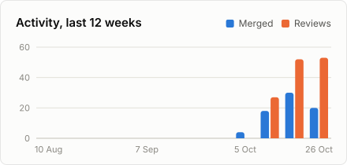

# Youssef Omar Bouden

DevOps engineer in Tunis, Tunisia. I build cloud and GPU infrastructure for AI/ML teams and automate the operations around it.

## About

- Platform engineering across AWS, Azure, GCP, OpenStack and VMware, with Terraform as the common thread and Argo CD for delivery.
- GPU infrastructure for AI/ML on NVIDIA and AMD: GPU-enabled Kubernetes nodes, driver and operator lifecycle, utilisation monitoring with DCGM.
- Current focus: cloud cost engineering (FinOps), migration automation, and shifting security left in CI/CD with Trivy, SonarQube and Infisical.
- Upstream, most of my work goes into [llm-d](https://github.com/llm-d), Kubernetes-native distributed inference, alongside fixes across the Kubernetes and cloud provider ecosystem.

## Certifications

| Certification | Issuer | Issued |
| --- | --- | --- |
| AWS Certified Machine Learning Engineer – Associate | Amazon Web Services | Aug 2026 |
| AWS Certified Solutions Architect – Associate | Amazon Web Services | Jan 2026 |
| Aviatrix Certified Engineer, Multicloud Network Associate | Aviatrix | Aug 2025 |
| AWS Certified Cloud Practitioner | Amazon Web Services | Mar 2025 |

Credentials are verifiable on [LinkedIn](https://www.linkedin.com/in/youssef-omar-bouden-348b6a197/details/certifications/).

## Open source

<!-- OSS-CONTRIBUTIONS:START -->

<picture>
  <source media="(prefers-color-scheme: dark)" srcset="profile/oss-summary-dark.svg">
  
</picture>

### Recent merged work

<a href="https://github.com/kai-scheduler/KAI-Scheduler/pull/2469">
<picture>
  <source media="(prefers-color-scheme: dark)" srcset="profile/pr-1-dark.svg">
  
</picture>
</a>
<a href="https://github.com/NVIDIA/NVSentinel/pull/2093">
<picture>
  <source media="(prefers-color-scheme: dark)" srcset="profile/pr-2-dark.svg">
  
</picture>
</a>
<a href="https://github.com/aws-controllers-k8s/elasticache-controller/pull/243">
<picture>
  <source media="(prefers-color-scheme: dark)" srcset="profile/pr-3-dark.svg">
  
</picture>
</a>
<a href="https://github.com/aws-controllers-k8s/cloudwatchlogs-controller/pull/85">
<picture>
  <source media="(prefers-color-scheme: dark)" srcset="profile/pr-4-dark.svg">
  
</picture>
</a>
<a href="https://github.com/aws-controllers-k8s/sqs-controller/pull/123">
<picture>
  <source media="(prefers-color-scheme: dark)" srcset="profile/pr-5-dark.svg">
  
</picture>
</a>
<a href="https://github.com/aws-controllers-k8s/firehose-controller/pull/36">
<picture>
  <source media="(prefers-color-scheme: dark)" srcset="profile/pr-6-dark.svg">
  
</picture>
</a>
<a href="https://github.com/aws-controllers-k8s/rds-controller/pull/327">
<picture>
  <source media="(prefers-color-scheme: dark)" srcset="profile/pr-7-dark.svg">
  
</picture>
</a>
<a href="https://github.com/kubescape/kubevuln/pull/1193">
<picture>
  <source media="(prefers-color-scheme: dark)" srcset="profile/pr-8-dark.svg">
  
</picture>
</a>

[All 52 merged pull requests](https://github.com/search?q=is%3Apr+author%3Ablacksoxx+is%3Amerged+-user%3Ablacksoxx&type=pullrequests)

### Projects

<table>
<tr>
<td align="center" width="16%"><a href="https://github.com/search?q=is%3Apr+author%3Ablacksoxx+is%3Amerged+user%3Akubescape&type=pullrequests"> <b>kubescape</b></a> 16 merged</td>
<td align="center" width="16%"><a href="https://github.com/search?q=is%3Apr+author%3Ablacksoxx+is%3Amerged+user%3Allm-d&type=pullrequests"> <b>llm-d</b></a> 14 merged</td>
<td align="center" width="16%"><a href="https://github.com/search?q=is%3Apr+author%3Ablacksoxx+is%3Amerged+user%3Aaws-controllers-k8s&type=pullrequests"> <b>aws-controllers-k8s</b></a> 9 merged</td>
<td align="center" width="16%"><a href="https://github.com/search?q=is%3Apr+author%3Ablacksoxx+is%3Amerged+user%3Apulumi&type=pullrequests"> <b>pulumi</b></a> 4 merged</td>
<td align="center" width="16%"><a href="https://github.com/search?q=is%3Apr+author%3Ablacksoxx+is%3Amerged+user%3ANVIDIA&type=pullrequests"> <b>NVIDIA</b></a> 2 merged</td>
<td align="center" width="16%"><a href="https://github.com/search?q=is%3Apr+author%3Ablacksoxx+is%3Amerged+user%3Akai-scheduler&type=pullrequests"> <b>kai-scheduler</b></a> 1 merged</td>
</tr>
<tr>
<td align="center" width="16%"><a href="https://github.com/search?q=is%3Apr+author%3Ablacksoxx+is%3Amerged+user%3AGoogleCloudPlatform&type=pullrequests"> <b>GoogleCloudPlatform</b></a> 1 merged</td>
<td align="center" width="16%"><a href="https://github.com/search?q=is%3Apr+author%3Ablacksoxx+is%3Amerged+user%3AFluidifyAI&type=pullrequests"> <b>FluidifyAI</b></a> 1 merged</td>
<td align="center" width="16%"><a href="https://github.com/search?q=is%3Apr+author%3Ablacksoxx+is%3Amerged+user%3Ak0sproject&type=pullrequests"> <b>k0sproject</b></a> 1 merged</td>
<td align="center" width="16%"><a href="https://github.com/search?q=is%3Apr+author%3Ablacksoxx+is%3Amerged+user%3ADokploy&type=pullrequests"> <b>Dokploy</b></a> 1 merged</td>
<td align="center" width="16%"><a href="https://github.com/search?q=is%3Apr+author%3Ablacksoxx+is%3Amerged+user%3Afalcosecurity&type=pullrequests"> <b>falcosecurity</b></a> 1 merged</td>
<td align="center" width="16%"><a href="https://github.com/search?q=is%3Apr+author%3Ablacksoxx+is%3Amerged+user%3A1devspace&type=pullrequests"> <b>1devspace</b></a> 1 merged</td>
</tr>
</table>

Open pull requests in 25 more organisations:

### Reviews and issues

- Reviewed [79 pull requests](https://github.com/search?q=is%3Apr+reviewed-by%3Ablacksoxx+-author%3Ablacksoxx&type=pullrequests) in [llm-d/llm-d-router](https://github.com/llm-d/llm-d-router), [loft-sh/vcluster](https://github.com/loft-sh/vcluster), [llm-d/llm-d](https://github.com/llm-d/llm-d) and 23 more.
- Opened [40 issues](https://github.com/search?q=is%3Aissue+author%3Ablacksoxx+-user%3Ablacksoxx&type=issues) in [llm-d/llm-d-router](https://github.com/llm-d/llm-d-router), [loft-sh/vcluster](https://github.com/loft-sh/vcluster), [finopsfoundation/focus_validator](https://github.com/finopsfoundation/focus_validator) and 16 more.

<picture>
  <source media="(prefers-color-scheme: dark)" srcset="profile/oss-activity-dark.svg">
  
</picture>
<picture>
  <source media="(prefers-color-scheme: dark)" srcset="profile/oss-languages-dark.svg">
  
</picture>

All 81 projects, including 78 open pull requests

| Project | Stars | Merged | Reviewed | Open |
| --- | ---: | ---: | ---: | ---: |
| [llm-d/llm-d-router](https://github.com/llm-d/llm-d-router) | 431 | [9](https://github.com/llm-d/llm-d-router/pulls?q=is%3Apr+author%3Ablacksoxx+is%3Amerged) | [26](https://github.com/llm-d/llm-d-router/pulls?q=is%3Apr+reviewed-by%3Ablacksoxx+-author%3Ablacksoxx) | [4](https://github.com/llm-d/llm-d-router/pulls?q=is%3Apr+author%3Ablacksoxx+is%3Aopen) |
| [kubescape/operator](https://github.com/kubescape/operator) | 25 | [6](https://github.com/kubescape/operator/pulls?q=is%3Apr+author%3Ablacksoxx+is%3Amerged) | [1](https://github.com/kubescape/operator/pulls?q=is%3Apr+reviewed-by%3Ablacksoxx+-author%3Ablacksoxx) | – |
| [llm-d/llm-d](https://github.com/llm-d/llm-d) | 5k | [4](https://github.com/llm-d/llm-d/pulls?q=is%3Apr+author%3Ablacksoxx+is%3Amerged) | [5](https://github.com/llm-d/llm-d/pulls?q=is%3Apr+reviewed-by%3Ablacksoxx+-author%3Ablacksoxx) | [2](https://github.com/llm-d/llm-d/pulls?q=is%3Apr+author%3Ablacksoxx+is%3Aopen) |
| [kubescape/kubevuln](https://github.com/kubescape/kubevuln) | 27 | [3](https://github.com/kubescape/kubevuln/pulls?q=is%3Apr+author%3Ablacksoxx+is%3Amerged) | [3](https://github.com/kubescape/kubevuln/pulls?q=is%3Apr+reviewed-by%3Ablacksoxx+-author%3Ablacksoxx) | – |
| [kubescape/helm-charts](https://github.com/kubescape/helm-charts) | 42 | [3](https://github.com/kubescape/helm-charts/pulls?q=is%3Apr+author%3Ablacksoxx+is%3Amerged) | [2](https://github.com/kubescape/helm-charts/pulls?q=is%3Apr+reviewed-by%3Ablacksoxx+-author%3Ablacksoxx) | – |
| [kubescape/storage](https://github.com/kubescape/storage) | 6 | [3](https://github.com/kubescape/storage/pulls?q=is%3Apr+author%3Ablacksoxx+is%3Amerged) | [1](https://github.com/kubescape/storage/pulls?q=is%3Apr+reviewed-by%3Ablacksoxx+-author%3Ablacksoxx) | – |
| [pulumi/pulumi](https://github.com/pulumi/pulumi) | 25.8k | [2](https://github.com/pulumi/pulumi/pulls?q=is%3Apr+author%3Ablacksoxx+is%3Amerged) | – | [5](https://github.com/pulumi/pulumi/pulls?q=is%3Apr+author%3Ablacksoxx+is%3Aopen) |
| [NVIDIA/NVSentinel](https://github.com/NVIDIA/NVSentinel) | 413 | [2](https://github.com/NVIDIA/NVSentinel/pulls?q=is%3Apr+author%3Ablacksoxx+is%3Amerged) | – | [1](https://github.com/NVIDIA/NVSentinel/pulls?q=is%3Apr+author%3Ablacksoxx+is%3Aopen) |
| [pulumi/pulumi-kubernetes-operator](https://github.com/pulumi/pulumi-kubernetes-operator) | 293 | [2](https://github.com/pulumi/pulumi-kubernetes-operator/pulls?q=is%3Apr+author%3Ablacksoxx+is%3Amerged) | – | – |
| [aws-controllers-k8s/rds-controller](https://github.com/aws-controllers-k8s/rds-controller) | 103 | [2](https://github.com/aws-controllers-k8s/rds-controller/pulls?q=is%3Apr+author%3Ablacksoxx+is%3Amerged) | – | – |
| [aws-controllers-k8s/eks-controller](https://github.com/aws-controllers-k8s/eks-controller) | 48 | [2](https://github.com/aws-controllers-k8s/eks-controller/pulls?q=is%3Apr+author%3Ablacksoxx+is%3Amerged) | – | – |
| [kai-scheduler/KAI-Scheduler](https://github.com/kai-scheduler/KAI-Scheduler) | 1.6k | [1](https://github.com/kai-scheduler/KAI-Scheduler/pulls?q=is%3Apr+author%3Ablacksoxx+is%3Amerged) | [1](https://github.com/kai-scheduler/KAI-Scheduler/pulls?q=is%3Apr+reviewed-by%3Ablacksoxx+-author%3Ablacksoxx) | – |
| [aws-controllers-k8s/elasticache-controller](https://github.com/aws-controllers-k8s/elasticache-controller) | 24 | [1](https://github.com/aws-controllers-k8s/elasticache-controller/pulls?q=is%3Apr+author%3Ablacksoxx+is%3Amerged) | [1](https://github.com/aws-controllers-k8s/elasticache-controller/pulls?q=is%3Apr+reviewed-by%3Ablacksoxx+-author%3Ablacksoxx) | [2](https://github.com/aws-controllers-k8s/elasticache-controller/pulls?q=is%3Apr+author%3Ablacksoxx+is%3Aopen) |
| [GoogleCloudPlatform/cluster-toolkit](https://github.com/GoogleCloudPlatform/cluster-toolkit) | 367 | [1](https://github.com/GoogleCloudPlatform/cluster-toolkit/pulls?q=is%3Apr+author%3Ablacksoxx+is%3Amerged) | – | – |
| [FluidifyAI/Regen](https://github.com/FluidifyAI/Regen) | 91 | [1](https://github.com/FluidifyAI/Regen/pulls?q=is%3Apr+author%3Ablacksoxx+is%3Amerged) | – | – |
| [k0sproject/rig](https://github.com/k0sproject/rig) | 54 | [1](https://github.com/k0sproject/rig/pulls?q=is%3Apr+author%3Ablacksoxx+is%3Amerged) | – | – |
| [Dokploy/website](https://github.com/Dokploy/website) | 52 | [1](https://github.com/Dokploy/website/pulls?q=is%3Apr+author%3Ablacksoxx+is%3Amerged) | – | – |
| [falcosecurity/falco-operator](https://github.com/falcosecurity/falco-operator) | 46 | [1](https://github.com/falcosecurity/falco-operator/pulls?q=is%3Apr+author%3Ablacksoxx+is%3Amerged) | – | – |
| [aws-controllers-k8s/test-infra](https://github.com/aws-controllers-k8s/test-infra) | 26 | [1](https://github.com/aws-controllers-k8s/test-infra/pulls?q=is%3Apr+author%3Ablacksoxx+is%3Amerged) | – | – |
| [aws-controllers-k8s/sqs-controller](https://github.com/aws-controllers-k8s/sqs-controller) | 11 | [1](https://github.com/aws-controllers-k8s/sqs-controller/pulls?q=is%3Apr+author%3Ablacksoxx+is%3Amerged) | – | – |
| [aws-controllers-k8s/cloudwatchlogs-controller](https://github.com/aws-controllers-k8s/cloudwatchlogs-controller) | 2 | [1](https://github.com/aws-controllers-k8s/cloudwatchlogs-controller/pulls?q=is%3Apr+author%3Ablacksoxx+is%3Amerged) | – | – |
| [kubescape/prometheus-exporter](https://github.com/kubescape/prometheus-exporter) | 2 | [1](https://github.com/kubescape/prometheus-exporter/pulls?q=is%3Apr+author%3Ablacksoxx+is%3Amerged) | – | – |
| [llm-d/llm-d-infra](https://github.com/llm-d/llm-d-infra) | 2 | [1](https://github.com/llm-d/llm-d-infra/pulls?q=is%3Apr+author%3Ablacksoxx+is%3Amerged) | – | – |
| [aws-controllers-k8s/firehose-controller](https://github.com/aws-controllers-k8s/firehose-controller) | 1 | [1](https://github.com/aws-controllers-k8s/firehose-controller/pulls?q=is%3Apr+author%3Ablacksoxx+is%3Amerged) | – | [1](https://github.com/aws-controllers-k8s/firehose-controller/pulls?q=is%3Apr+author%3Ablacksoxx+is%3Aopen) |
| [1devspace/gpushare-operator](https://github.com/1devspace/gpushare-operator) | 0 | [1](https://github.com/1devspace/gpushare-operator/pulls?q=is%3Apr+author%3Ablacksoxx+is%3Amerged) | – | – |
| [loft-sh/vcluster](https://github.com/loft-sh/vcluster) | 11.4k | – | [12](https://github.com/loft-sh/vcluster/pulls?q=is%3Apr+reviewed-by%3Ablacksoxx+-author%3Ablacksoxx) | [7](https://github.com/loft-sh/vcluster/pulls?q=is%3Apr+author%3Ablacksoxx+is%3Aopen) |
| [NVIDIA/gpu-operator](https://github.com/NVIDIA/gpu-operator) | 2.9k | – | [4](https://github.com/NVIDIA/gpu-operator/pulls?q=is%3Apr+reviewed-by%3Ablacksoxx+-author%3Ablacksoxx) | [1](https://github.com/NVIDIA/gpu-operator/pulls?q=is%3Apr+author%3Ablacksoxx+is%3Aopen) |
| [aws-controllers-k8s/ec2-controller](https://github.com/aws-controllers-k8s/ec2-controller) | 44 | – | [3](https://github.com/aws-controllers-k8s/ec2-controller/pulls?q=is%3Apr+reviewed-by%3Ablacksoxx+-author%3Ablacksoxx) | [2](https://github.com/aws-controllers-k8s/ec2-controller/pulls?q=is%3Apr+author%3Ablacksoxx+is%3Aopen) |
| [finopsfoundation/focus_validator](https://github.com/finopsfoundation/focus_validator) | 43 | – | [3](https://github.com/finopsfoundation/focus_validator/pulls?q=is%3Apr+reviewed-by%3Ablacksoxx+-author%3Ablacksoxx) | [7](https://github.com/finopsfoundation/focus_validator/pulls?q=is%3Apr+author%3Ablacksoxx+is%3Aopen) |
| [kubescape/kubescape](https://github.com/kubescape/kubescape) | 11.8k | – | [2](https://github.com/kubescape/kubescape/pulls?q=is%3Apr+reviewed-by%3Ablacksoxx+-author%3Ablacksoxx) | – |
| [ai-dynamo/grove](https://github.com/ai-dynamo/grove) | 279 | – | [2](https://github.com/ai-dynamo/grove/pulls?q=is%3Apr+reviewed-by%3Ablacksoxx+-author%3Ablacksoxx) | [1](https://github.com/ai-dynamo/grove/pulls?q=is%3Apr+author%3Ablacksoxx+is%3Aopen) |
| [llm-d/llm-d-autoscaling](https://github.com/llm-d/llm-d-autoscaling) | 61 | – | [2](https://github.com/llm-d/llm-d-autoscaling/pulls?q=is%3Apr+reviewed-by%3Ablacksoxx+-author%3Ablacksoxx) | – |
| [NVIDIA/nvidia-container-toolkit](https://github.com/NVIDIA/nvidia-container-toolkit) | 4.6k | – | [1](https://github.com/NVIDIA/nvidia-container-toolkit/pulls?q=is%3Apr+reviewed-by%3Ablacksoxx+-author%3Ablacksoxx) | [1](https://github.com/NVIDIA/nvidia-container-toolkit/pulls?q=is%3Apr+author%3Ablacksoxx+is%3Aopen) |
| [NVIDIA/k8s-device-plugin](https://github.com/NVIDIA/k8s-device-plugin) | 3.9k | – | [1](https://github.com/NVIDIA/k8s-device-plugin/pulls?q=is%3Apr+reviewed-by%3Ablacksoxx+-author%3Ablacksoxx) | [1](https://github.com/NVIDIA/k8s-device-plugin/pulls?q=is%3Apr+author%3Ablacksoxx+is%3Aopen) |
| [aws-controllers-k8s/iam-controller](https://github.com/aws-controllers-k8s/iam-controller) | 64 | – | [1](https://github.com/aws-controllers-k8s/iam-controller/pulls?q=is%3Apr+reviewed-by%3Ablacksoxx+-author%3Ablacksoxx) | – |
| [aws-controllers-k8s/runtime](https://github.com/aws-controllers-k8s/runtime) | 48 | – | [1](https://github.com/aws-controllers-k8s/runtime/pulls?q=is%3Apr+reviewed-by%3Ablacksoxx+-author%3Ablacksoxx) | – |
| [aws-controllers-k8s/lambda-controller](https://github.com/aws-controllers-k8s/lambda-controller) | 18 | – | [1](https://github.com/aws-controllers-k8s/lambda-controller/pulls?q=is%3Apr+reviewed-by%3Ablacksoxx+-author%3Ablacksoxx) | – |
| [aws-controllers-k8s/dynamodb-controller](https://github.com/aws-controllers-k8s/dynamodb-controller) | 14 | – | [1](https://github.com/aws-controllers-k8s/dynamodb-controller/pulls?q=is%3Apr+reviewed-by%3Ablacksoxx+-author%3Ablacksoxx) | – |
| [aws-controllers-k8s/kafka-controller](https://github.com/aws-controllers-k8s/kafka-controller) | 4 | – | [1](https://github.com/aws-controllers-k8s/kafka-controller/pulls?q=is%3Apr+reviewed-by%3Ablacksoxx+-author%3Ablacksoxx) | [1](https://github.com/aws-controllers-k8s/kafka-controller/pulls?q=is%3Apr+author%3Ablacksoxx+is%3Aopen) |
| [aws-controllers-k8s/cloudwatch-controller](https://github.com/aws-controllers-k8s/cloudwatch-controller) | 3 | – | [1](https://github.com/aws-controllers-k8s/cloudwatch-controller/pulls?q=is%3Apr+reviewed-by%3Ablacksoxx+-author%3Ablacksoxx) | [1](https://github.com/aws-controllers-k8s/cloudwatch-controller/pulls?q=is%3Apr+author%3Ablacksoxx+is%3Aopen) |

…and 41 more.

<!-- OSS-CONTRIBUTIONS:END -->

## Featured projects

| Project | What it shows | Stack |
| --- | --- | --- |
| [azure-go-task-manager](https://github.com/blacksoxx/azure-go-task-manager) | Go microservices delivered to Kubernetes through Argo CD and Kustomize overlays | Go, Kubernetes, Argo CD, Kustomize, Azure |
| [gcp-microservices-tf](https://github.com/blacksoxx/gcp-microservices-tf) | Terraform that stands up GKE and hosts Google's Online Boutique demo end to end | Terraform, GKE, GCP |
| [hybrid-cloud-monitoring](https://github.com/blacksoxx/hybrid-cloud-monitoring) | One Terraform setup provisioning AWS and Azure resources with a single Grafana view across both | Terraform, Grafana, AWS, Azure |

## Tech stack

| Area | Tools |
| --- | --- |
| Cloud | AWS, Azure, Google Cloud, OpenStack, VMware |
| Infrastructure as code | Terraform, Ansible, Helm, Kustomize |
| Containers | Kubernetes, Docker, Podman |
| AI infrastructure | NVIDIA GPU Operator, Container Toolkit, DCGM, CUDA, AMD ROCm |
| CI/CD and GitOps | GitHub Actions, Jenkins, Argo CD |
| Security | Trivy, SonarQube, Infisical |
| Observability | Prometheus, Grafana, Elasticsearch, Logstash, Kibana, Sentry |
| Languages | Go, Python, TypeScript, Java, Bash |
